# Database Schema — SafePlant AI

## Entity Relationship Diagram

```mermaid
erDiagram
    Plant {
        uuid id PK
        string plant_code UK
        string name
        string location
        string region
        string timezone
        string status
        timestamp created_at
        timestamp updated_at
        boolean is_active
    }

    Machine {
        uuid id PK
        string machine_code UK
        uuid plant_id FK
        string name
        string machine_type
        string model_number
        string manufacturer
        string current_state
        float risk_score
        string status
        timestamp commissioned_at
        timestamp created_at
        timestamp updated_at
        boolean is_active
    }

    SafetyZone {
        uuid id PK
        string zone_code UK
        uuid plant_id FK
        string name
        string zone_type
        string hazard_level
        string description
        boolean is_active
        timestamp created_at
    }

    Interlock {
        uuid id PK
        string interlock_code UK
        uuid plant_id FK
        string name
        string interlock_type
        string current_state
        string description
        boolean is_safety_critical
        boolean is_active
        timestamp created_at
    }

    MachineSafetyZone {
        uuid id PK
        uuid machine_id FK
        uuid safety_zone_id FK
        timestamp effective_from
        timestamp effective_to
    }

    MachineInterlock {
        uuid id PK
        uuid machine_id FK
        uuid interlock_id FK
        boolean is_required
        timestamp effective_from
        timestamp effective_to
    }

    AlarmDefinition {
        uuid id PK
        string alarm_code UK
        uuid machine_id FK
        string name
        string description
        string severity
        string category
        float threshold_value
        string threshold_unit
        int ack_deadline_seconds
        boolean is_active
        timestamp created_at
    }

    AlarmEvent {
        uuid id PK
        string alarm_event_code UK
        uuid alarm_definition_id FK
        uuid machine_id FK
        uuid safety_zone_id FK
        float trigger_value
        string severity
        string status
        string acknowledgement_status
        timestamp alarm_timestamp
        timestamp cleared_timestamp
        timestamp ingested_at
        string source_fingerprint
        boolean is_replayed
        string generation_run_id
    }

    OperatorShift {
        uuid id PK
        string shift_code UK
        uuid plant_id FK
        string operator_name
        string operator_id
        string shift_type
        timestamp shift_start
        timestamp shift_end
        string status
        timestamp created_at
    }

    Acknowledgement {
        uuid id PK
        string ack_code UK
        uuid alarm_event_id FK
        uuid operator_shift_id FK
        string operator_id
        string operator_name
        timestamp ack_timestamp
        int response_time_seconds
        string status
        string validation_result
        string notes
        boolean is_anomalous
        timestamp created_at
    }

    Incident {
        uuid id PK
        string incident_code UK
        uuid plant_id FK
        uuid machine_id FK
        uuid safety_zone_id FK
        string severity
        string status
        string root_cause_category
        string description
        string assigned_engineer
        timestamp detected_at
        timestamp closed_at
        boolean has_missing_context
        string generation_run_id
        timestamp created_at
        timestamp updated_at
    }

    IncidentAlarm {
        uuid id PK
        uuid incident_id FK
        uuid alarm_event_id FK
        string relationship_type
        timestamp linked_at
    }

    IncidentStateEvent {
        uuid id PK
        uuid incident_id FK
        string from_state
        string to_state
        string transitioned_by
        string notes
        boolean is_valid
        timestamp transitioned_at
    }

    CorrectiveAction {
        uuid id PK
        string action_code UK
        uuid incident_id FK
        string description
        string assigned_engineer
        string priority
        string status
        timestamp due_at
        timestamp completed_at
        timestamp verified_at
        string verification_result
        boolean is_closed_without_verification
        timestamp created_at
        timestamp updated_at
    }

    CorrectiveActionEvent {
        uuid id PK
        uuid corrective_action_id FK
        string from_status
        string to_status
        string transitioned_by
        string notes
        boolean is_valid
        timestamp transitioned_at
    }

    MachineStateEvent {
        uuid id PK
        uuid machine_id FK
        string from_state
        string to_state
        boolean is_valid_transition
        string trigger_reason
        timestamp occurred_at
        string generation_run_id
    }

    InterlockStateEvent {
        uuid id PK
        uuid interlock_id FK
        uuid machine_id FK
        string from_state
        string to_state
        boolean is_valid_combination
        string unsafe_condition_code
        timestamp occurred_at
        string generation_run_id
    }

    AuditLog {
        uuid id PK
        string entity_type
        uuid entity_id
        string action
        string actor
        jsonb before_state
        jsonb after_state
        string ip_address
        timestamp occurred_at
    }

    GenerationRun {
        uuid id PK
        string run_code UK
        string mode
        int seed
        timestamp started_at
        timestamp completed_at
        string status
        jsonb entity_counts
        jsonb configuration
        string checksum
    }

    ValidationRun {
        uuid id PK
        string run_code UK
        uuid generation_run_id FK
        timestamp started_at
        timestamp completed_at
        string overall_status
        jsonb check_results
        int total_checks
        int passed_checks
        int failed_checks
        int expected_anomalies
        int unexpected_failures
    }

    Plant ||--o{ Machine : "has"
    Plant ||--o{ SafetyZone : "contains"
    Plant ||--o{ Interlock : "has"
    Plant ||--o{ OperatorShift : "schedules"
    Plant ||--o{ Incident : "records"
    Machine ||--o{ AlarmDefinition : "defines"
    Machine ||--o{ AlarmEvent : "generates"
    Machine ||--o{ MachineStateEvent : "transitions"
    Machine }o--o{ SafetyZone : "MachineSafetyZone"
    Machine }o--o{ Interlock : "MachineInterlock"
    AlarmDefinition ||--o{ AlarmEvent : "instances"
    AlarmEvent ||--o{ Acknowledgement : "acknowledged_by"
    AlarmEvent }o--o{ Incident : "IncidentAlarm"
    Incident ||--o{ CorrectiveAction : "requires"
    Incident ||--o{ IncidentStateEvent : "history"
    CorrectiveAction ||--o{ CorrectiveActionEvent : "history"
    Interlock ||--o{ InterlockStateEvent : "transitions"
    OperatorShift ||--o{ Acknowledgement : "performed"
    GenerationRun ||--o{ ValidationRun : "validated_by"
```



---

## Cardinalities

| Relationship | Cardinality | Notes |
|---|---|---|
| Plant → Machine | 1:N | A plant has many machines |
| Plant → SafetyZone | 1:N | A plant has many zones |
| Plant → Interlock | 1:N | A plant has many interlocks |
| Plant → OperatorShift | 1:N | A plant schedules shifts |
| Machine ↔ SafetyZone | N:M | Via MachineSafetyZone bridge |
| Machine ↔ Interlock | N:M | Via MachineInterlock bridge |
| Machine → AlarmDefinition | 1:N | A machine has many alarm types |
| AlarmDefinition → AlarmEvent | 1:N | Each definition produces many events |
| Machine → MachineStateEvent | 1:N | Immutable state history |
| AlarmEvent → Acknowledgement | 1:N | Multiple ack attempts preserved |
| OperatorShift → Acknowledgement | 1:N | Operator acks alarms during shift |
| Incident → CorrectiveAction | 1:N | An incident requires actions |
| Incident ↔ AlarmEvent | N:M | Via IncidentAlarm bridge |
| Incident → IncidentStateEvent | 1:N | Immutable lifecycle history |
| CorrectiveAction → CorrectiveActionEvent | 1:N | Immutable status history |

---

## Indexes

```sql
-- AlarmEvent (most queried table - 50,000+ rows)
CREATE INDEX idx_alarm_event_machine ON alarm_event(machine_id);
CREATE INDEX idx_alarm_event_severity ON alarm_event(severity);
CREATE INDEX idx_alarm_event_timestamp ON alarm_event(alarm_timestamp);
CREATE INDEX idx_alarm_event_ack_status ON alarm_event(acknowledgement_status);
CREATE INDEX idx_alarm_event_fingerprint ON alarm_event(source_fingerprint);
CREATE INDEX idx_alarm_event_run ON alarm_event(generation_run_id);

-- Incident
CREATE INDEX idx_incident_machine ON incident(machine_id);
CREATE INDEX idx_incident_status ON incident(status);
CREATE INDEX idx_incident_severity ON incident(severity);
CREATE INDEX idx_incident_detected ON incident(detected_at);

-- MachineStateEvent
CREATE INDEX idx_mse_machine ON machine_state_event(machine_id);
CREATE INDEX idx_mse_timestamp ON machine_state_event(occurred_at);

-- Acknowledgement
CREATE INDEX idx_ack_alarm ON acknowledgement(alarm_event_id);
CREATE INDEX idx_ack_shift ON acknowledgement(operator_shift_id);

-- OperatorShift
CREATE INDEX idx_shift_plant ON operator_shift(plant_id);
CREATE INDEX idx_shift_dates ON operator_shift(shift_start, shift_end);

-- AuditLog
CREATE INDEX idx_audit_entity ON audit_log(entity_type, entity_id);
CREATE INDEX idx_audit_time ON audit_log(occurred_at);
```

---

## Constraints and Business Rules

- No CASCADE DELETE on alarm events or incident history (preserve safety evidence)
- Soft delete via `is_active` / `status` fields on master records
- Enum constraints enforced at application layer and documented at DB layer
- All timestamps stored in UTC
- UUID primary keys (uuid4) for all tables
